# Observability in Kubernetes: Prometheus & Grafana

## 1. What is Observability?

Observability is the ability to understand the internal state of a system by analyzing the data it generates, such as metrics, logs, traces, and events.

In simple terms, observability helps engineers understand:

- What is happening inside the system?
- Why is the system behaving unexpectedly?
- Where is a failure occurring?
- What is causing performance degradation?
- How can the root cause of a problem be identified?

### Example

Imagine that you have deployed an application in production. The application is running, but users are experiencing:

- Slow response times
- Login failures
- API timeouts
- High CPU utilization
- Memory consumption
- Database connection errors

Simply checking whether the application is running is not enough. Engineers need visibility into the application's internal behavior.

This is where observability becomes important.

---

## 2. Observability Components

Observability commonly involves the following components:

| Component | Purpose | Example |
|---|---|---|
| Metrics | Numerical measurements of system performance | CPU usage: 75% |
| Logging | Records events occurring inside applications | Database connection failed |
| Tracing | Tracks a request across multiple services | API → Service → Database |
| Alerting | Notifies engineers when conditions are abnormal | CPU usage above 90% |
| Visualization | Displays telemetry through dashboards | Grafana Dashboard |

---

## 3. Monitoring

### What is Monitoring?

Monitoring is the process of continuously observing the health, availability, and performance of systems using predefined metrics and conditions.

Monitoring helps answer questions such as:

- Is the server running?
- Is CPU utilization increasing?
- How much memory is being consumed?
- Are Pods healthy?
- Is network traffic normal?
- Are requests failing?
- Is disk space running low?

### Example

| Node | CPU | Memory | Status |
|---|---:|---:|---|
| Master | 25% | 48% | Healthy |
| Worker 1 | 92% | 87% | Warning |
| Worker 2 | 35% | 42% | Healthy |

Monitoring allows engineers to identify Worker 1 as a potential performance bottleneck.

### Monitoring vs Observability

| Monitoring | Observability |
|---|---|
| Detects known problems | Helps investigate unknown problems |
| Uses predefined metrics and thresholds | Uses metrics, logs, traces, and other telemetry |
| Tells us that something is wrong | Helps investigate why something is wrong |
| Focuses on detection | Focuses on understanding and diagnosis |

**Monitoring is a part of observability. Observability is a broader concept.**

---

## 4. Metrics

Metrics are numerical measurements collected over time to represent the performance or behavior of a system.

### Examples of Metrics

- CPU utilization
- Memory usage
- Disk utilization
- Network traffic
- HTTP request count
- Error rate
- Response time
- Container restart count
- Database connections
- Application throughput

### Example: CPU Metrics Over Time

| Time | CPU Usage |
|---|---:|
| 10:00 AM | 20% |
| 10:05 AM | 35% |
| 10:10 AM | 65% |
| 10:15 AM | 92% |

This trend indicates that CPU utilization is continuously increasing.

Metrics help identify performance patterns, resource bottlenecks, and abnormal behavior.

### Metric Types

#### Counter

A counter is a cumulative metric that generally increases over time and resets when the monitored process restarts.

Examples:

- Total HTTP requests
- Total errors
- Total bytes transmitted
- Total completed jobs

#### Gauge

A gauge represents a value that can increase or decrease.

Examples:

- Current memory usage
- Active connections
- CPU temperature
- Queue size

#### Histogram

A histogram samples observations and groups them into configurable buckets.

Examples:

- API response latency
- Request duration
- Database query duration

Histograms are useful for understanding distributions and calculating quantiles.

#### Summary

A summary samples observations and calculates statistical distributions, commonly quantiles, over a configured time window.

---

## 5. Logging

### What is Logging?

Logging is the process of recording events that occur inside an application, operating system, or infrastructure.

Logs provide detailed information about application behavior and help engineers investigate errors.

### Logs Can Help Identify

- Application crashes
- Authentication failures
- Database errors
- API failures
- Configuration issues
- Security events
- Unexpected application behavior

### Example Application Logs

```log
2026-11-19 10:00:01 INFO  Application started
2026-11-19 10:01:10 INFO  User login successful
2026-11-19 10:02:15 ERROR Database connection failed
2026-11-19 10:02:20 WARN  Retry attempt 1
```

### Metrics vs Logs

| Metrics | Logs |
|---|---|
| Numerical measurements | Event records |
| Useful for trends | Useful for detailed investigation |
| CPU usage is 90% | Database connection timeout |
| Lightweight for continuous monitoring | Provides contextual information |
| Used in graphs and dashboards | Used for troubleshooting |

---

## 6. Distributed Tracing

### What is Tracing?

Distributed tracing tracks a request as it travels through multiple services in a distributed system.

Modern applications may contain several services. A single request may travel through an API Gateway, application services, databases, and other dependencies.

Tracing helps identify where latency occurs and how requests flow through the system.

### Example: E-Commerce Application

```text
Client
  |
  v
API Gateway
  |
  v
Order Service
  |
  v
Payment Service
  |
  v
Database
```

Suppose an order request takes 8 seconds.

| Service | Duration |
|---|---:|
| API Gateway | 100 ms |
| Order Service | 200 ms |
| Payment Service | 6,500 ms |
| Database | 1,200 ms |

Tracing helps identify the Payment Service as the major source of latency.

### Important Tracing Terms

- **Trace:** The complete journey of one request through a distributed system.
- **Span:** An individual operation within a trace.
- **Trace ID:** Unique identifier for a complete request journey.
- **Span ID:** Identifier for an individual operation.

Tracing is especially useful for debugging microservices and distributed applications.

---

## 7. Alerting

### What is Alerting?

Alerting is the process of automatically notifying engineers when a system meets predefined conditions that require attention.

Without alerting, engineers must manually inspect dashboards.

With alerting, the system notifies the responsible team when a problem or abnormal condition occurs.

### Example

```text
IF CPU Usage > 90%
FOR 5 Minutes
THEN Send Alert
```

This means CPU usage must remain above 90% for five continuous minutes before the alert is triggered.

### Why Use Alert Duration?

A CPU spike lasting only two seconds may not represent a serious problem.

Alert durations help avoid notifications for temporary spikes and reduce alert fatigue.

### Common Alerts

| Alert | Condition |
|---|---|
| High CPU | CPU usage exceeds threshold |
| High Memory | Memory utilization becomes critical |
| Node Down | Node becomes unavailable |
| Pod Crash | Pod repeatedly restarts |
| High Error Rate | Too many failed requests |
| Disk Full | Storage capacity is running low |
| API Latency | Requests take too long |

---

## 8. Observability Workflow

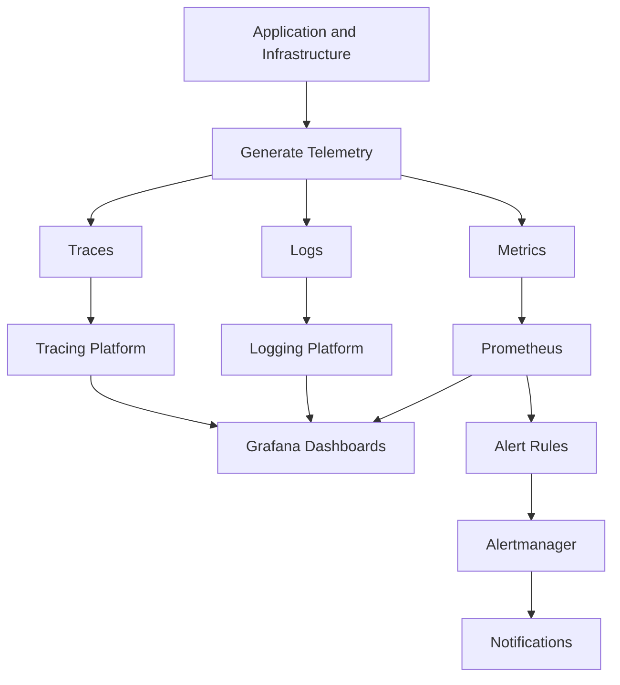

### Workflow Explanation

1. Applications and infrastructure generate telemetry.
2. Metrics are collected and stored.
3. Logs are collected for detailed investigation.
4. Traces track requests across services.
5. Grafana visualizes relevant telemetry.
6. Alert rules detect abnormal conditions.
7. Notifications are sent to responsible engineers.

---

# 9. Prometheus

## What is Prometheus?

Prometheus is an open-source monitoring and alerting system designed to collect, store, query, and analyze time-series metrics.

Prometheus is commonly used for monitoring:

- Servers
- Kubernetes clusters
- Containers
- Applications
- Microservices
- Databases
- Network infrastructure

### Why Prometheus?

Suppose you want to monitor CPU usage every five minutes.

| Time | CPU Usage |
|---|---:|
| 10:00 | 20% |
| 10:05 | 25% |
| 10:10 | 48% |
| 10:15 | 70% |
| 10:20 | 90% |

Prometheus collects and stores these measurements so engineers can analyze trends over time.

---

## 10. Time-Series Database

A time-series database stores data points associated with timestamps.

A Prometheus time series generally consists of:

- Metric name
- Labels
- Timestamp
- Value

### Example

```text
cpu_usage{instance="worker-1",environment="production"} 75
```

| Component | Meaning |
|---|---|
| `cpu_usage` | Metric name |
| `instance="worker-1"` | Instance label |
| `environment="production"` | Environment label |
| `75` | Metric value |

### Why is Time Important?

Without timestamps, we only know the current CPU utilization.

With historical data, we can understand:

- Whether CPU usage is increasing
- When the issue started
- Whether the issue is recurring
- Whether a deployment caused performance changes
- How infrastructure behaves during peak hours

---

## 11. Prometheus Architecture

### Main Components

| Component | Responsibility |
|---|---|
| Prometheus Server | Collects and stores metrics |
| Scrape Engine | Pulls metrics from targets |
| TSDB | Stores time-series data |
| PromQL | Queries and analyzes metrics |
| Exporters | Expose metrics from systems |
| Alerting Rules | Evaluate monitoring conditions |
| Alertmanager | Handles alert grouping and notifications |

### How Prometheus Works

1. A target exposes metrics.
2. Prometheus periodically scrapes the target.
3. Metrics are stored in its time-series database.
4. Engineers query the data using PromQL.
5. Grafana visualizes the data.
6. Alert rules evaluate conditions.
7. Alertmanager handles notifications.

---

## 12. Pull-Based Monitoring

Prometheus primarily follows a pull-based monitoring model.

Instead of monitored systems sending metrics directly to Prometheus, Prometheus periodically requests metrics from targets.

```text
Prometheus Server
       |
       | HTTP Scrape Request
       v
Metrics Endpoint
       |
       | Metrics Response
       v
Prometheus Server
```

### Advantages of Pull Model

- Prometheus controls the collection interval.
- Targets do not need to know the Prometheus server address.
- Target availability can be checked.
- Monitoring targets can be configured and discovered.

### Pull vs Push

| Pull Model | Push Model |
|---|---|
| Prometheus requests data | Sender sends data |
| Prometheus controls scraping | Sender controls sending |
| Common Prometheus architecture | Used for specific collection scenarios |

Prometheus Pushgateway supports certain push-based use cases, especially short-lived batch jobs.

---

## 13. Exporters

### What is an Exporter?

An exporter is a tool or service that collects metrics from a system and exposes them in a format Prometheus can scrape.

Exporters are useful when systems do not natively expose Prometheus-compatible metrics.

### Node Exporter

Node Exporter exposes hardware and operating-system metrics from Linux and Unix-like systems.

It can expose:

- CPU
- Memory
- Filesystem
- Disk
- Network
- System load

### Example Metrics

```text
node_cpu_seconds_total
node_memory_MemAvailable_bytes
node_filesystem_avail_bytes
node_network_receive_bytes_total
node_network_transmit_bytes_total
```

### Monitoring Flow

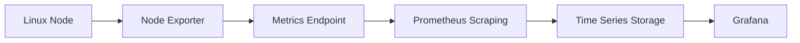

**Interview Answer:**

Node Exporter collects system-level metrics from Linux machines and exposes them through an HTTP endpoint. Prometheus scrapes that endpoint and stores the metrics for monitoring and analysis.

---

# 14. Kubernetes Monitoring

## Why Monitor Kubernetes?

Kubernetes is a container orchestration platform that manages:

- Pods
- Nodes
- Deployments
- Services
- ReplicaSets
- Scheduling
- Resource allocation
- Application health

A Kubernetes cluster can appear healthy while applications are experiencing failures.

### Common Issues

- Node CPU overload
- Pod restarts
- Memory pressure
- Container crashes
- Network problems
- Application errors
- Scheduling failures

### Kubernetes Monitoring Areas

| Area | Metrics |
|---|---|
| Nodes | CPU, memory, disk, network |
| Pods | Status, usage, restarts |
| Containers | CPU, memory, resource usage |
| Cluster | Node health, scheduling |
| Applications | Latency, errors, request count |

### Kubernetes Monitoring Components

| Component | Role |
|---|---|
| Prometheus | Collects and stores metrics |
| Node Exporter | Exposes host-level metrics |
| kube-state-metrics | Exposes Kubernetes object-state metrics |
| Grafana | Visualization and dashboards |
| Alertmanager | Alert routing and notifications |

### Node Exporter vs kube-state-metrics

| Node Exporter | kube-state-metrics |
|---|---|
| Host-level metrics | Kubernetes object-state metrics |
| CPU, memory, filesystem, network | Pods, deployments, replicas, status |
| Monitors OS and machine resources | Monitors Kubernetes resource state |

These tools provide different types of information and complement each other.

---

# 15. Docker

## What is Docker?

Docker is a platform for building, packaging, and running applications inside containers.

Containers help applications run consistently across different environments.

### Traditional Deployment Problem

An application may work on a developer's machine but fail on a production server due to:

- Different dependencies
- Different library versions
- Different runtime versions
- Different configurations

Docker packages the application and its dependencies into an image.

### Docker Architecture

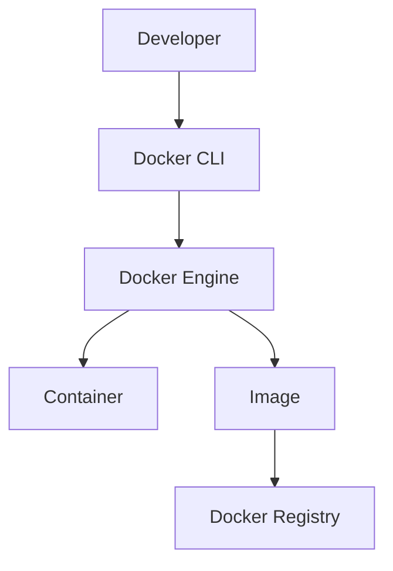

### Docker Terms

| Term | Meaning |
|---|---|
| Image | Template used to create containers |
| Container | Running instance of an image |
| Docker Engine | Container runtime and management engine |
| Dockerfile | Instructions for building an image |
| Registry | Stores and distributes images |
| Volume | Persistent data storage |
| Network | Communication between containers |

### Why Docker in this Project?

Docker is used as the foundation for running Kind Kubernetes clusters.

Kind creates Kubernetes nodes as Docker containers, allowing Kubernetes environments to run without creating separate physical or virtual machines for each node.

---

# 16. Kubernetes

## What is Kubernetes?

Kubernetes is an open-source container orchestration platform used to deploy, scale, manage, and maintain containerized applications.

Docker runs containers, but managing hundreds of containers across multiple machines becomes difficult.

Kubernetes automates many of these operations.

### Kubernetes Solves

- Container deployment
- Scaling
- Container restarts
- Load distribution
- Service discovery
- Rolling updates
- Resource management
- Self-healing

### Kubernetes Architecture

A Kubernetes cluster consists of:

1. Control Plane
2. Worker Nodes

### Control Plane Components

| Component | Purpose |
|---|---|
| API Server | Entry point for Kubernetes API |
| Scheduler | Selects nodes for Pods |
| Controller Manager | Maintains desired state |
| etcd | Stores cluster state |

### Worker Node Components

| Component | Purpose |
|---|---|
| Kubelet | Manages Pods on the node and communicates with the control plane |
| Container Runtime | Runs containers |
| Networking Components | Enable networking and connectivity |

### What is a Pod?

A Pod is the smallest deployable unit in Kubernetes.

A Pod can contain one or more containers that share certain resources such as networking and storage.

```text
Kubernetes Cluster
│
├── Control Plane
│
├── Worker Node 1
│   ├── Pod
│   │   └── Container
│   └── Pod
│       └── Container
│
└── Worker Node 2
    └── Pod
        └── Container
```

Kubernetes manages workloads through Pods instead of directly managing containers as standalone resources.

---

# 17. Kind

## What is Kind?

Kind stands for **Kubernetes in Docker**.

It is a tool for creating Kubernetes clusters using Docker containers as nodes.

### Kind is Useful For

- Local Kubernetes learning
- Development
- Testing
- CI pipelines
- Reproducing Kubernetes environments

### Kind Cluster Example

A cluster may contain:

- One control-plane node
- Two worker nodes

These nodes run as Docker containers.

### Traditional Cluster vs Kind

| Traditional Cluster | Kind Cluster |
|---|---|
| Physical or virtual machines | Docker containers act as nodes |
| Infrastructure setup required | Faster local setup |
| Production infrastructure | Primarily development and testing |
| Higher resource requirements | Often lighter for labs |

### Kind Architecture

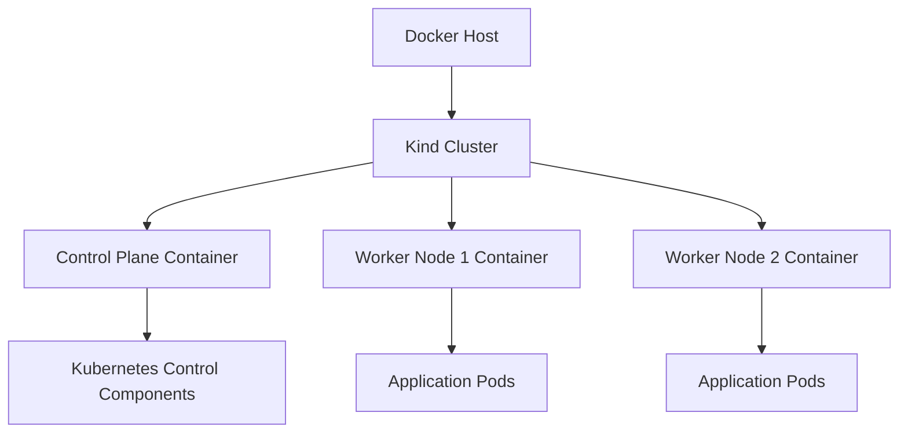

Kind is primarily designed for development and testing, not as a production cluster solution.

---

# 18. kubectl

## What is kubectl?

kubectl is the command-line tool used to interact with Kubernetes clusters.

It communicates with the Kubernetes API Server.

### Using kubectl, Engineers Can

- Deploy applications
- Inspect Pods
- Check nodes
- View logs
- Create resources
- Delete resources
- Troubleshoot problems

### Essential Commands

| Command | Purpose |
|---|---|
| `kubectl get nodes` | List nodes |
| `kubectl get pods` | List Pods |
| `kubectl get deployments` | List deployments |
| `kubectl get services` | List Services |
| `kubectl get all` | Show common resources |
| `kubectl describe pod <name>` | Detailed Pod information |
| `kubectl logs <pod>` | View container logs |
| `kubectl apply -f file.yaml` | Apply manifests |
| `kubectl delete -f file.yaml` | Delete resources from manifests |
| `kubectl get pods -A` | List Pods in all namespaces |

### What is a Namespace?

A Namespace logically separates resources inside a Kubernetes cluster.

```text
Kubernetes Cluster
│
├── default
│   └── Application Pods
│
├── monitoring
│   ├── Prometheus
│   ├── Grafana
│   └── Alertmanager
│
└── development
    └── Test Applications
```

Namespaces help organize resources and support access control and resource management.

---

# 19. GitOps

## What is GitOps?

GitOps is an operational approach where Git acts as the source of truth for the desired state of infrastructure and application deployment configuration.

Instead of manually changing the Kubernetes cluster, engineers maintain the desired configuration in Git.

Automation continuously compares the desired state with the actual state and reconciles differences.

### Traditional Deployment

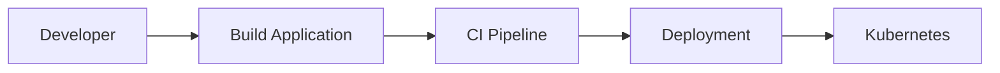

### GitOps Deployment

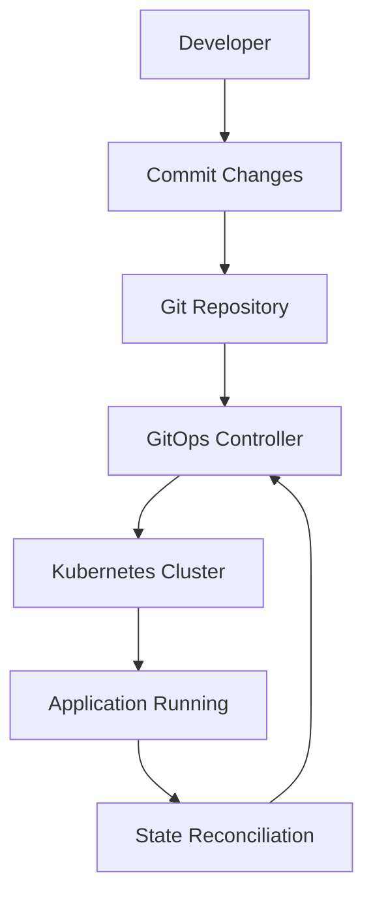

### Benefits of GitOps

- Version-controlled configuration
- Easier rollback
- Auditable changes
- Consistent environments
- Reduced manual configuration drift
- Repeatable deployments

GitOps does not eliminate CI/CD. CI can still build, test, scan, and publish container images.

GitOps focuses on how the desired deployment state is delivered and maintained in the target environment.

---

# 20. Argo CD

## What is Argo CD?

Argo CD is a declarative GitOps continuous delivery tool for Kubernetes.

It monitors Git repositories containing Kubernetes configuration and helps synchronize the desired state with the Kubernetes cluster.

### How Argo CD Works

1. Developer changes application configuration.
2. Configuration is pushed to Git.
3. Argo CD monitors the repository.
4. Argo CD compares the desired state with the actual state.
5. Synchronization is performed manually or automatically according to configuration.
6. Kubernetes is reconciled toward the desired state.

### Argo CD Terminology

| Term | Meaning |
|---|---|
| Desired State | What configuration says should exist |
| Actual State | What currently exists in the cluster |
| Sync | Reconcile cluster to desired state |
| Out of Sync | Actual state differs from Git |
| Synced | Actual state matches desired configuration |
| Healthy | Resources are operating according to health checks |

### GitOps Example

Suppose Git contains:

```yaml
replicas: 3
```

But the cluster currently has only two replicas.

Argo CD detects the difference.

Depending on the configured synchronization policy, it can synchronize the cluster to restore the desired state of three replicas.

This is a core GitOps principle:

**Declarative desired-state reconciliation.**

---

# 21. Helm

## What is Helm?

Helm is a package manager for Kubernetes.

It simplifies installing, configuring, upgrading, and managing Kubernetes applications.

Installing Prometheus may require several Kubernetes resources:

- Deployments
- StatefulSets
- Services
- ConfigMaps
- Secrets
- RBAC
- Persistent Volumes

Instead of manually applying every resource, Helm allows engineers to package and manage applications using Helm Charts.

### Helm Terminology

| Term | Explanation |
|---|---|
| Chart | Package containing Kubernetes templates and configuration |
| Release | Installed instance of a Helm chart |
| Repository | Location where charts are distributed |
| Values | Configuration values used to customize charts |
| Templates | Kubernetes manifests generated by Helm |

### Without Helm

```text
prometheus-deployment.yaml
prometheus-service.yaml
prometheus-config.yaml
prometheus-rbac.yaml
prometheus-storage.yaml
```

These resources need to be managed separately.

### With Helm

```text
Helm Chart
    ↓
Values Configuration
    ↓
Rendered Kubernetes Manifests
    ↓
Deployment to Cluster
```

### Helm Workflow

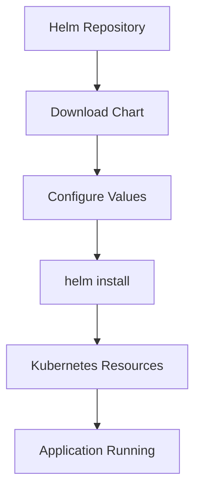

### Common Helm Commands

```bash
# Add a repository
helm repo add prometheus-community <repository-url>

# Update repositories
helm repo update

# Search charts
helm search repo prometheus

# Install a chart
helm install monitoring-stack prometheus-community/<chart-name>

# List releases
helm list -A

# Upgrade release
helm upgrade monitoring-stack prometheus-community/<chart-name>

# Uninstall release
helm uninstall monitoring-stack
```

### Helm vs kubectl

| kubectl | Helm |
|---|---|
| Directly manages Kubernetes resources | Manages applications through charts and releases |
| Apply individual manifests | Deploy charts with multiple resources |
| Manual configuration organization | Reusable templates and values |
| Resource-oriented | Package and release-oriented |

**Interview Definition:**

Helm is a package manager for Kubernetes that uses charts to simplify the deployment, configuration, upgrade, and lifecycle management of Kubernetes applications.

---

# 22. PromQL

## What is PromQL?

PromQL stands for **Prometheus Query Language**.

It is used to query, filter, aggregate, and analyze time-series metrics stored in Prometheus.

PromQL helps answer questions such as:

- What is the current CPU usage?
- How many requests are being received?
- What is the error rate?
- How much memory is being used?
- How has traffic changed over the last five minutes?

### Basic PromQL

```promql
metric_name
```

Example:

```promql
node_memory_MemAvailable_bytes
```

This retrieves available memory metrics from monitored nodes.

### Filtering with Labels

```promql
http_requests_total{status="500"}
```

This selects HTTP request metrics where the status label is 500.

### Using rate()

```promql
rate(http_requests_total[5m])
```

Calculates the average per-second increase in HTTP requests over the last five minutes.

### Using sum()

```promql
sum(rate(http_requests_total[5m]))
```

Aggregates per-second request rates from all matching time series.

### Using sum by()

```promql
sum by (status) (rate(http_requests_total[5m]))
```

Calculates request rates and groups the results by HTTP status.

### Important PromQL Functions

| Function | Purpose |
|---|---|
| `rate()` | Average per-second increase of a counter over a range |
| `increase()` | Total counter increase over a specified period |
| `sum()` | Add values together |
| `avg()` | Calculate average |
| `max()` | Highest value |
| `min()` | Lowest value |
| `count()` | Count time series or values |
| `by()` | Group results by labels |
| `without()` | Aggregate while excluding selected labels |

---

# 23. Grafana

## What is Grafana?

Grafana is an observability and visualization platform used to query, visualize, monitor, and analyze data from different sources.

It transforms metrics into dashboards that are easier to understand.

### Prometheus vs Grafana

| Prometheus | Grafana |
|---|---|
| Collects metrics | Visualizes metrics |
| Stores time-series data | Creates dashboards |
| Provides PromQL | Provides panels and visualizations |
| Evaluates alert rules | Displays metrics and alert status |
| Monitoring backend | Visualization platform |

### Grafana Architecture

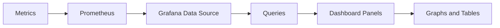

### Important Grafana Concepts

#### Data Source

A data source is where Grafana retrieves data.

Examples:

- Prometheus
- PostgreSQL
- MySQL
- Elasticsearch
- Loki

#### Dashboard

A dashboard is a collection of visualizations related to a system or workload.

#### Panel

A panel is an individual visualization.

Examples:

- CPU usage graph
- Memory gauge
- Network traffic graph
- Pod count
- Error-rate panel

#### Variables

Variables allow dashboards to be dynamic.

Example:

```text
Namespace = default / production / staging
Node = worker-1 / worker-2 / worker-3
```

#### Dashboard Import

Grafana supports importing prebuilt dashboards using dashboard IDs or JSON.

This is useful because Kubernetes dashboards often contain many predefined panels and queries.

---

# 24. Alertmanager

## What is Alertmanager?

Alertmanager is a component commonly used with Prometheus to manage alerts generated from Prometheus alerting rules.

It handles:

- Alert grouping
- Deduplication
- Routing
- Silencing
- Inhibition
- Notification delivery

### Alerting Architecture

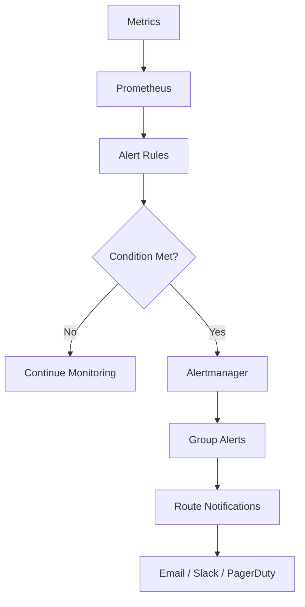

### Example Alert Rule

```yaml
groups:
  - name: system-alerts
    rules:
      - alert: HighCPUUsage
        expr: cpu_usage_percent > 90
        for: 5m
        labels:
          severity: critical
        annotations:
          summary: High CPU usage detected
          description: CPU usage has exceeded 90% for 5 minutes.
```

### Alert Rule Explanation

| Field | Purpose |
|---|---|
| `alert` | Alert name |
| `expr` | PromQL expression |
| `for` | Duration condition must remain true |
| `labels` | Alert classification |
| `annotations` | Human-readable alert details |

---

# 25. How Prometheus and Grafana Work Together

Prometheus and Grafana are not competitors. They perform different jobs and complement each other.

### Real-World Flow

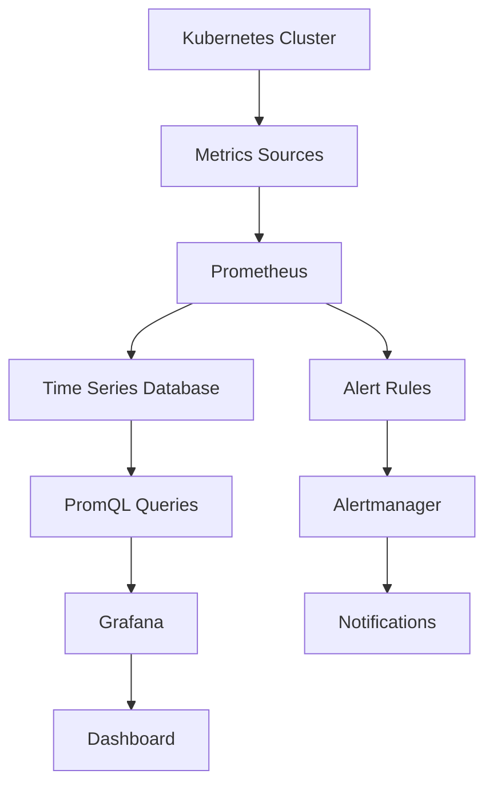

### Example Scenario

You have deployed an application on Kubernetes.

You want to monitor:

- Node CPU
- Node memory
- Pod restarts
- Application response time
- Network traffic
- Request volume

Prometheus collects and stores metrics.

Grafana queries Prometheus and presents metrics through dashboards.

Alertmanager handles notifications when configured alert rules trigger.

---

# 26. What is a Dashboard?

A dashboard is a visual representation of important system information.

A good dashboard should answer operational questions quickly.

### Kubernetes Dashboard Panels

| Dashboard Panel | Purpose |
|---|---|
| Cluster CPU | CPU consumption |
| Cluster Memory | Memory usage |
| Node Status | Healthy or unavailable nodes |
| Pod Count | Number of running workloads |
| Pod Restarts | Container instability |
| Network Traffic | Incoming and outgoing traffic |
| Disk Usage | Storage capacity |
| API Latency | Application performance |

### Dashboard Design Principles

- Show critical information first.
- Avoid unnecessary graphs.
- Use clear labels.
- Keep consistent units.
- Provide time filters.
- Include thresholds.
- Make abnormal conditions visually obvious.

---

# 27. Project Architecture

The project combines several DevOps tools to deploy an application and monitor the Kubernetes environment.

### Components

| Component | Role |
|---|---|
| AWS EC2 | Host machine for the lab |
| Ubuntu/Linux | Operating system |
| Docker | Container runtime and Kind foundation |
| Kind | Creates Kubernetes cluster |
| Kubernetes | Orchestrates application containers |
| kubectl | Cluster administration |
| Helm | Installs packaged Kubernetes applications |
| Prometheus | Metrics collection and storage |
| Node Exporter | Host-level metrics |
| Grafana | Dashboard visualization |
| Alertmanager | Alert routing and notifications |
| Argo CD | GitOps-based deployment management |
| GitHub | Stores project code and configuration |

### Architecture

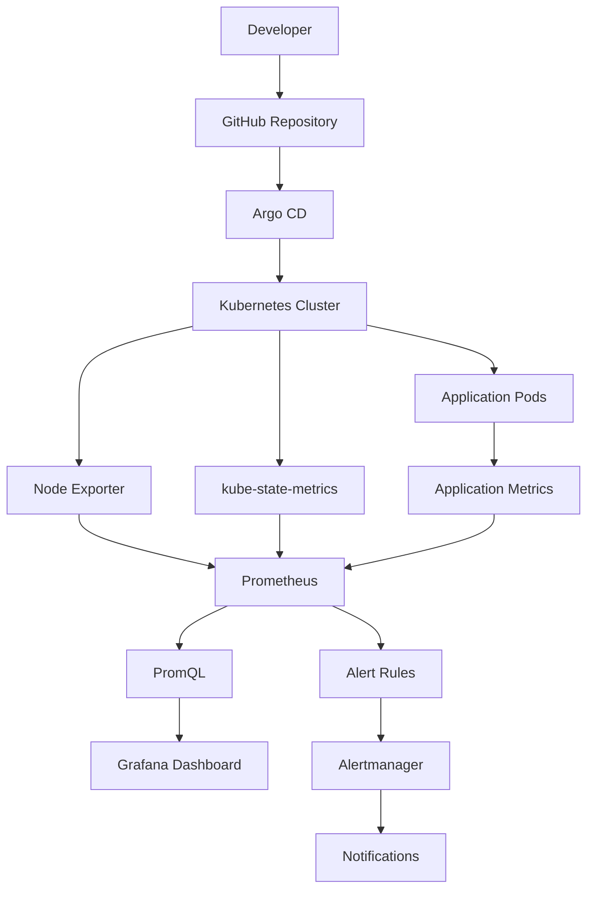

---

# 28. Project Deployment Flow

## Step 1: Prepare Infrastructure

Create a Linux server and prepare the environment.

```bash
sudo apt update
sudo apt upgrade -y
```

Install required tools following the installation instructions for your Linux distribution and versions.

## Step 2: Install Docker

Docker is required because Kind uses Docker containers to create Kubernetes nodes.

Verify installation:

```bash
docker --version
```

Check running containers:

```bash
docker ps
```

## Step 3: Install Kind

Kind creates a Kubernetes cluster using Docker containers.

Verify installation:

```bash
kind version
```

Create your cluster using a cluster configuration file.

## Step 4: Create Kubernetes Cluster

Create the Kind cluster with the desired configuration.

Verify nodes:

```bash
kubectl get nodes
```

## Step 5: Install kubectl

Verify:

```bash
kubectl version --client
```

Check the cluster:

```bash
kubectl get nodes
```

## Step 6: Deploy the Application

Kubernetes manifests define the resources required for your application.

Example project structure:

```text
project/
│
├── application/
│   ├── deployment.yaml
│   ├── service.yaml
│   └── configmap.yaml
│
├── monitoring/
│   ├── prometheus.yaml
│   └── grafana.yaml
│
└── kind/
    └── cluster-config.yaml
```

Deploy:

```bash
kubectl apply -f application/
```

Verify:

```bash
kubectl get pods
kubectl get deployments
kubectl get services
```

## Step 7: Create Monitoring Namespace

```bash
kubectl create namespace monitoring
```

Check:

```bash
kubectl get namespaces
```

### Why?

- Organization
- Separation of workloads
- Easier resource management
- Easier administration
- Better access control

## Step 8: Install Helm

Verify:

```bash
helm version
```

Add a chart repository:

```bash
helm repo add prometheus-community <repository-url>
```

Update repository information:

```bash
helm repo update
```

## Step 9: Deploy Prometheus Stack

A monitoring stack may include:

- Prometheus
- Grafana
- Alertmanager
- Node Exporter
- kube-state-metrics

The exact resources depend on the selected chart and configuration.

After deployment:

```bash
kubectl get pods -n monitoring
```

## Step 10: Verify Monitoring Components

Check Pods:

```bash
kubectl get pods -n monitoring
```

Check Services:

```bash
kubectl get services -n monitoring
```

Check logs:

```bash
kubectl logs <pod-name> -n monitoring
```

Check resource details:

```bash
kubectl describe pod <pod-name> -n monitoring
```

## Step 11: Access Prometheus

Prometheus provides a web interface for querying metrics and checking targets.

Use port forwarding in a lab environment:

```bash
kubectl port-forward -n monitoring svc/<prometheus-service> 9090:9090
```

Open:

```text
http://localhost:9090
```

### Check Targets

Navigate to the Prometheus Targets page.

Targets should show healthy status when they are reachable and metrics are being scraped successfully.

### What Does UP Mean?

`UP` means Prometheus successfully scraped the target during the latest scrape attempt.

`DOWN` indicates a scrape failure.

However, UP does not guarantee that the monitored application is functioning correctly from a user perspective.

It only indicates that the monitoring target is reachable and scrapeable.

## Step 12: Query Metrics

Try the following queries, depending on the exporters and metrics available.

### Check Target Status

```promql
up
```

### Container CPU Usage Rate

```promql
rate(container_cpu_usage_seconds_total[5m])
```

### Available System Memory

```promql
node_memory_MemAvailable_bytes
```

### Incoming Network Traffic Rate

```promql
rate(node_network_receive_bytes_total[5m])
```

## Step 13: Install and Access Grafana

Grafana commonly uses port `3000` for the service in the project's configuration.

In a local lab, you can use port forwarding:

```bash
kubectl port-forward -n monitoring svc/<grafana-service> 3000:80
```

Open:

```text
http://localhost:3000
```

## Step 14: Configure Data Source

Grafana needs a data source to retrieve information.

```text
Grafana
   ↓
Data Source
   ↓
Prometheus
   ↓
Metrics
```

Once Prometheus is connected, Grafana can query the metrics.

## Step 15: Create Dashboard

Add visualizations such as:

- CPU usage
- Memory usage
- Network traffic
- Pod count
- Node status
- Container restarts

Each panel uses a query to retrieve data.

---

# 29. Monitoring a Real Application

Monitoring without workload activity may show mostly flat graphs.

To understand system behavior, observe it under different conditions.

### Normal Load

```text
CPU: 15%
Memory: 40%
Requests: Low
```

### Increased Traffic

```text
CPU: 65%
Memory: 58%
Requests: Increased
```

### High Load

```text
CPU: 95%
Memory: 89%
Requests: Very High
```

This allows us to compare system behavior across different workloads.

### Performance Testing vs Monitoring

| Performance Testing | Monitoring |
|---|---|
| Deliberately creates workload | Continuously observes workload |
| Evaluates capacity and performance | Tracks ongoing system health |
| May be scheduled | Generally continuous |
| Helps find bottlenecks | Helps detect issues |

---

# 30. Alert Rules: Practical Examples

## Alert 1: High CPU Usage

Concept:

```promql
CPU usage > 90%
```

Example configuration:

```yaml
alert: HighCPUUsage
expr: cpu_usage_percent > 90
for: 5m
```

Meaning:

If CPU remains above 90% for five minutes, generate an alert.

## Alert 2: Target Down

```promql
up == 0
```

Meaning:

The target has failed to scrape or is unavailable to Prometheus.

## Alert 3: High Memory Usage

Concept:

```promql
memory_usage_percent > 85
```

Meaning:

Memory utilization has exceeded the defined threshold.

## Alert 4: High Request Rate

```promql
rate(http_requests_total[5m])
```

This can help detect unusual traffic patterns, but a high request rate is not automatically an error.

Thresholds should be based on the application's normal behavior and capacity.

---

# 31. Infrastructure Monitoring vs Application Monitoring

This distinction is very important for DevOps engineers.

| Infrastructure Monitoring | Application Monitoring |
|---|---|
| Server CPU | API response time |
| RAM usage | Request error rate |
| Disk usage | Business transaction failures |
| Network interface | Application latency |
| Node availability | Application availability |
| System load | User experience |

A server can be healthy while the application is broken.

### Example

```text
Server CPU: 20%
Memory: 35%
Node: UP

Application: ERROR
Database Connection: FAILED
```

Therefore, monitoring only the server is not enough.

---

# 32. Metrics, Logs and Traces: Real Scenario

Suppose users report that the website is slow.

### Step 1: Metrics

Grafana shows that API response latency has increased.

### Step 2: Logs

Application logs show database timeout errors.

### Step 3: Traces

Tracing shows that the database query is taking four seconds.

### Step 4: Root Cause

A slow database query or database overload is responsible for the delay.

This is the power of observability.

Instead of guessing, engineers use different types of telemetry to investigate a problem.

---

# 33. DevOps Interview Questions

## Q1. What is Observability?

Observability is the ability to understand the internal state of a system using the telemetry it produces, primarily metrics, logs, and traces.

## Q2. What is Prometheus?

Prometheus is an open-source monitoring and alerting system that collects and stores time-series metrics and supports querying them using PromQL.

## Q3. What is Grafana?

Grafana is a visualization platform that connects to data sources and presents data using dashboards, graphs, panels, and alerts.

## Q4. What is PromQL?

PromQL is Prometheus's query language used to select, filter, aggregate, and analyze time-series metrics.

## Q5. What is Node Exporter?

Node Exporter exposes Linux system and hardware metrics in a format that Prometheus can scrape.

## Q6. What is Alertmanager?

Alertmanager receives alerts from Prometheus and manages grouping, deduplication, routing, silencing, inhibition, and notification delivery.

## Q7. What is Helm?

Helm is a package manager for Kubernetes that simplifies installation, configuration, upgrades, and management of applications using charts.

## Q8. What is a Helm Chart?

A Helm Chart is a package of templates and configuration used to deploy Kubernetes resources.

## Q9. What is Kind?

Kind is a tool that runs Kubernetes clusters using Docker containers as cluster nodes. It is useful for local development and testing.

## Q10. What is kubectl?

kubectl is the Kubernetes CLI used to interact with the Kubernetes API and manage cluster resources.

## Q11. What is Argo CD?

Argo CD is a declarative GitOps continuous delivery tool for Kubernetes that synchronizes cluster resources with configurations stored in Git.

## Q12. What is GitOps?

GitOps is an approach in which Git stores the desired configuration state, and automation reconciles the running environment to that state.

## Q13. What is the difference between Prometheus and Grafana?

Prometheus primarily collects, stores, and queries metrics. Grafana primarily visualizes data from sources such as Prometheus.

## Q14. What is a Time-Series Database?

A time-series database stores data points associated with timestamps, allowing analysis of trends and changes over time.

## Q15. What is Scraping?

Scraping is the process by which Prometheus periodically fetches metrics from configured targets.

## Q16. What is a Prometheus Target?

A target is an endpoint from which Prometheus collects metrics.

## Q17. What is a Data Source in Grafana?

A data source is the configured backend from which Grafana queries data, such as Prometheus.

## Q18. What is a Dashboard?

A dashboard is a collection of visual panels used to monitor and analyze system data.

## Q19. What is a Counter?

A counter is a metric that generally increases over time and resets when the monitored process restarts.

## Q20. What is a Gauge?

A gauge is a metric that can increase or decrease, such as current memory usage.

---

# 34. Important Technical Corrections

The source transcript was generated using speech recognition, so some tool names and statements were incorrect.

| Incorrect Wording | Correct Understanding |
|---|---|
| Observatary | Observability |
| Grafalco | Grafana |
| Kuber Nities | Kubernetes |
| Hem | Helm |
| Kube CTL | kubectl |
| Time Series Database | Prometheus stores time-series metrics |
| Docker and Kubernetes | Docker is not required for every Kubernetes cluster |
| Grafana collects metrics | Grafana usually queries a metrics backend such as Prometheus |
| Node Exporter | Exposes host-level metrics |
| Argo CD | GitOps continuous delivery and reconciliation tool |

### Security Considerations

Avoid:

- Opening every port to `0.0.0.0/0`
- Exposing Prometheus publicly
- Exposing Grafana without secure authentication
- Using default passwords
- Sharing administrator credentials
- Running unnecessary publicly accessible services

Prefer:

- Private network access
- VPN or SSH tunnels
- Restricted IP allowlists
- HTTPS
- Strong credentials
- Secrets management
- Least privilege access
- Cloud security groups with only required ports

For learning environments, accessing Prometheus and Grafana through SSH tunnels or Kubernetes port-forwarding is often safer than exposing them directly to the internet.

---

# 35. Learning Roadmap

## Phase 1: Foundations

Linux → Docker → Networking → Git

## Phase 2: Container Orchestration

Kubernetes → Pods → Deployments → Services → Namespaces → kubectl

## Phase 3: Kubernetes Packaging and GitOps

Helm → Charts → Values → Argo CD → GitOps

## Phase 4: Observability

Metrics → Prometheus → Exporters → PromQL

## Phase 5: Visualization and Alerting

Grafana → Dashboards → Alert Rules → Alertmanager

## Phase 6: Real Project

Deploy Application → Monitor → Generate Load → Detect Issue → Troubleshoot → Fix

---

# 36. Hands-on Practice Checklist

## Infrastructure

- [ ] Prepare Linux server
- [ ] Install Docker
- [ ] Understand Docker images and containers
- [ ] Install Kind
- [ ] Create Kubernetes cluster
- [ ] Verify cluster nodes using kubectl

## Application Deployment

- [ ] Deploy sample application
- [ ] Create Namespace
- [ ] Deploy Pods and Services
- [ ] Check application logs
- [ ] Understand NodePort and port forwarding

## Monitoring

- [ ] Install Helm
- [ ] Add chart repository
- [ ] Install Prometheus stack
- [ ] Verify monitoring Pods
- [ ] Check Prometheus targets
- [ ] Query metrics using PromQL

## Visualization

- [ ] Access Grafana
- [ ] Configure Prometheus data source
- [ ] Create CPU panel
- [ ] Create memory panel
- [ ] Create network panel
- [ ] Import Kubernetes dashboard

## Alerting

- [ ] Understand alert conditions
- [ ] Create CPU alert
- [ ] Create availability alert
- [ ] Configure Alertmanager
- [ ] Test notification workflow

## GitOps

- [ ] Store manifests in Git
- [ ] Connect Argo CD to Git repository
- [ ] Deploy using GitOps
- [ ] Observe Out of Sync status
- [ ] Synchronize desired state

---

# 37. The Most Important Mental Model

Do not memorize these tools as isolated technologies.

Understand how they work together.

| Tool | Role |
|---|---|
| Docker | Packages and runs applications in containers |
| Kubernetes | Orchestrates containerized applications |
| Kind | Creates local Kubernetes clusters using Docker |
| kubectl | Communicates with and manages Kubernetes |
| Helm | Packages and manages Kubernetes applications |
| Argo CD | Synchronizes Kubernetes applications with desired Git state |
| Prometheus | Collects, stores, and queries metrics |
| Grafana | Visualizes monitoring data |
| Alertmanager | Handles and routes alerts |

## One-Line Summary

> Docker runs containers, Kubernetes manages containers, Helm packages Kubernetes applications, Argo CD implements GitOps deployment workflows, Prometheus collects metrics, Grafana visualizes metrics, and Alertmanager handles alert notifications.

---

# 38. How to Study This Project

Learn every tool using three layers:

### 1. Concept

Understand what the tool is and what problem it solves.

### 2. Architecture

Understand how it communicates with other tools and components.

### 3. Hands-on

Install it, configure it, create failures, observe metrics, troubleshoot, and fix problems.

This approach will help you move beyond memorizing definitions and develop practical DevOps troubleshooting skills.
